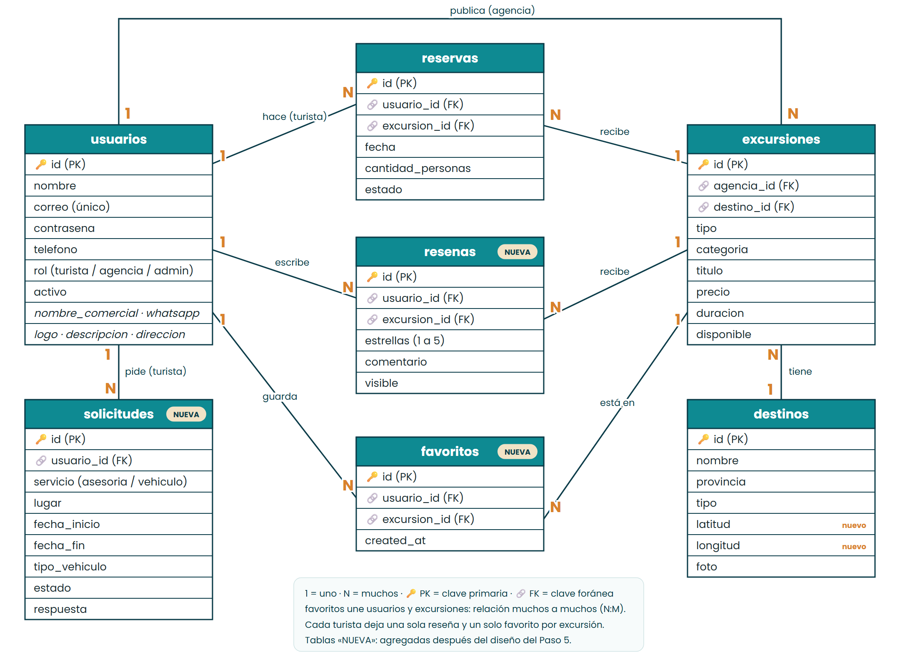

# 🌴 Explora RD

**Plataforma turística de República Dominicana.** Cualquier persona puede descubrir destinos, encontrar excursiones y contactar directamente con agencias turísticas desde un solo lugar, en computadora o celular.

Proyecto de **Ana Esther Hernández Hernández** — 5to A, Politécnico Cristiano James Davis (prof. Luis Margarin).

---

## ¿Qué hace?

| Para… | Puede… |
|---|---|
| **Turistas** | Explorar 12 destinos (también en un **mapa**), buscar excursiones por destino, categoría, tipo, precio y **mejor valoradas**, ver la ficha de cada una, escribir a la agencia por WhatsApp, **solicitar reservas** y cancelarlas, guardar excursiones en **favoritos** ❤️, dejar **reseñas con estrellas** de las excursiones que ya hizo, y pedir **asesorías de viaje** y **renta de vehículos**. |
| **Agencias** | Tener su **perfil público** (logo, presentación, fotos, videos, contacto y WhatsApp), **publicar excursiones y paquetes**, **confirmar o rechazar reservas** desde su panel privado, y ver cuántas veces guardaron sus excursiones y su **calificación promedio**. |
| **Administrador** | Gestionar **usuarios y agencias** (crear, editar, suspender, borrar), **destinos** (fotos, descripción, actividades, traducciones y **ubicación en el mapa**), **moderar excursiones y reseñas**, **supervisar todas las reservas**, **atender las solicitudes** de asesoría y renta de vehículos y ver el **reporte de estadísticas con gráficas** (hecho en Python). |

## Páginas

| Página | Dirección | Qué tiene |
|---|---|---|
| Inicio | `/` | Portada tropical, buscador con pestañas, destinos, excursiones, circuitos, servicios, galería, preguntas frecuentes y contacto |
| Destinos | `/destinos` | Los 12 destinos con filtro por tipo y **mapa interactivo** |
| Un destino | `/destinos/jarabacoa` | Fotos, descripción, qué hacer, excursiones, **mapa pequeño** y «Cómo llegar» |
| Excursiones | `/excursiones` | Catálogo con buscador, filtros y orden (precio o mejor valoradas) |
| Una excursión | `/excursiones/catamaran-a-isla-saona` | Ficha, reserva, WhatsApp, favoritos y **opiniones de viajeros** |
| Agencias | `/agencias` | Lista y perfil público de cada agencia |
| Galería | `/galeria` | Todas las fotos con filtro y **visor en grande** (con el crédito de cada autor) |
| Asesorías | `/asesorias` | Cómo funciona, en qué ayudamos y formulario de solicitud |
| Renta de vehículos | `/renta-de-vehiculos` | Tipos de vehículo, consejos para manejar y formulario de solicitud |
| Entrar / Registro | `/login`, `/registro` | Inicio de sesión y registro de turista o agencia |
| Mi cuenta (turista) | `/mi-cuenta` | Reservas, favoritos y solicitudes |
| Panel de la agencia | `/agencia/panel` | Resumen, perfil, excursiones y reservas |
| Panel del administrador | `/admin` | Usuarios, destinos, excursiones, reservas, solicitudes, reseñas y **reporte de Python** |

## Base de datos



Diagrama también en [`docs/diagrama_entidad_relacion.svg`](docs/diagrama_entidad_relacion.svg) (se puede ampliar sin perder calidad).

| Tabla | Para qué sirve |
|---|---|
| `usuarios` | Turistas, agencias y administradores (campo `rol`). Las agencias tienen además nombre comercial, logo, WhatsApp, fotos y videos. |
| `destinos` | Los lugares del país, con su tipo (playa, montaña o ciudad), traducciones y **ubicación** (`latitud`, `longitud`). |
| `excursiones` | Excursiones, circuitos y paquetes que publica cada agencia en un destino. |
| `reservas` | Lo que un turista reserva de una excursión (pendiente, confirmada o cancelada). |
| `solicitudes` | Pedidos de **asesoría de viaje** o **renta de vehículo** que atiende el administrador. |
| `resenas` | Opinión de 1 a 5 estrellas de un turista sobre una excursión que ya hizo. |
| `favoritos` | Excursiones que un turista guardó con el corazón. |

**Relaciones:**
- Una agencia publica muchas excursiones (**1:N**) y un destino tiene muchas excursiones (**1:N**).
- Un turista hace muchas reservas, solicitudes y reseñas (**1:N** cada una), y una excursión recibe muchas reservas y reseñas (**1:N**).
- Turistas y excursiones se unen por `favoritos`: un turista guarda muchas excursiones y una excursión la guardan muchos turistas (**N:M**).
- Un turista deja **una sola** reseña y **un solo** favorito por excursión (índice único en la base de datos).

Las tablas `solicitudes`, `resenas` y `favoritos`, y la ubicación de los destinos, se agregaron después del diseño del Paso 5.

## Idiomas

La página está en **español** (por defecto), **inglés** y **francés**. Se cambia con el botón ES / EN / FR del menú.

- Los textos de la página están en `lang/en.json` y `lang/fr.json` (la clave es la frase en español).
- Los errores de los formularios, en `lang/en/validation.php` y `lang/fr/validation.php`.
- La descripción y las actividades de cada destino se traducen desde el panel del administrador (sección «Traducciones»).
- Lo que escriben las agencias (títulos y descripciones de excursiones) se muestra tal como lo escribieron, con un aviso.
- Los paneles de agencia y de administrador están solo en español.

## Tecnologías

- **Laravel 13** (PHP 8.3 o más reciente) con vistas **Blade**
- **MySQL** (WampServer en la computadora de desarrollo)
- **Bootstrap 5**, HTML, CSS y JavaScript
- **Python** con **matplotlib** para el reporte de estadísticas del administrador (ver [`python/LEEME.md`](python/LEEME.md))
- **Leaflet** con mapas de **OpenStreetMap** para el mapa de destinos (gratis, sin cuenta; se carga desde internet)
- **Claude** (IA de Anthropic, modelo Claude Opus 5.5) para el asistente «Pregúntale a Explora RD»
- Letras **Lora** y **Poppins** (Google Fonts) · Colores turquesa `#0E8A92`, azul `#0B3C49`, blanco y arena `#F1E3C6`

## Cómo ponerlo a funcionar en la computadora

1. Encender **WampServer** (icono en verde) y crear la base de datos `explora_rd` en phpMyAdmin.
2. En la carpeta del proyecto:
   ```bash
   composer install
   copy .env.example .env
   php artisan key:generate
   php artisan migrate --seed
   php artisan storage:link
   php artisan serve
   ```
3. Abrir **http://127.0.0.1:8000**

Las cuentas de prueba están en `database/seeders/UsuarioSeeder.php` (solo para la computadora, **nunca** para la página publicada).

## Asistente con IA («Pregúntale a Explora RD»)

En todas las páginas públicas hay un botón ✨ **«Pregúntale a Explora RD»** (encima del de WhatsApp) que abre un chat.
El turista hace preguntas abiertas («¿Qué hago en Samaná con niños?») y responde **Claude**, la IA de Anthropic.

- La IA solo usa la **información real de la página**: destinos, excursiones publicadas (precio, duración, agencia, estrellas, enlace), servicios y preguntas frecuentes (`app/Support/Asistente/ContextoTuristico.php`).
- Responde en el idioma del turista, recomienda excursiones **con su enlace**, no inventa precios y no hace reservas: envía a la ficha o al WhatsApp de la agencia.
- Máximo 8 preguntas por minuto por persona. No se guarda nada en la base de datos (la conversación vive solo en la pestaña del navegador).
- **Sin clave sale como «Próximamente»**: el botón dice «Asistente IA · Próximamente» y la ventana ofrece WhatsApp (sin caja para escribir). Al poner la clave se vuelve el chat de verdad, sin tocar el código.

**Para activarlo (una sola vez):**
1. ✅ El paquete oficial ya está instalado (`anthropic-ai/sdk` en `composer.json`). En otra computadora basta con `composer install`.
2. Crear una clave en **console.anthropic.com** (necesita cuenta y créditos) y escribirla en `.env`:
   ```
   ANTHROPIC_API_KEY=la-clave-aquí
   ```
   ⚠️ La clave es secreta: `.env` no se sube a GitHub. Nunca la pegues en el código ni en un chat.
3. Reiniciar `php artisan serve` (y `php artisan config:clear` si la configuración está en caché).

Costo aproximado con Claude Opus 5.5: entre 1 y 3 centavos de dólar por pregunta. Se puede cambiar de modelo con `EXPLORA_IA_MODELO` en `.env`.

## Pruebas automáticas

```bash
php artisan test
```

Hay **146 pruebas** de Laravel que revisan las páginas, el registro, los roles, el panel de agencias, las reservas, el panel del administrador, las asesorías y la renta de vehículos, las reseñas, los favoritos, el mapa, la galería, el reporte, el asistente con IA, los idiomas y el recorrido completo del diagrama de flujo. El programa de Python tiene **8 pruebas** más:

```bash
python -m unittest discover -s python -v
```

Ver también [`PLAN_DE_PRUEBAS.md`](PLAN_DE_PRUEBAS.md).

## Publicar en internet

- **Gratis, con subdominio (InfinityFree, sin terminal):** [`GUIA_INFINITYFREE.md`](GUIA_INFINITYFREE.md). El paquete listo para subir se crea con `scripts\preparar-infinityfree.ps1`.
- **Hosting de pago con cPanel y SSH (para una agencia de verdad):** [`GUIA_PUBLICACION.md`](GUIA_PUBLICACION.md).

## Estructura principal

```
app/Http/Controllers/        Controladores (páginas, paneles, reservas, solicitudes, reseñas, favoritos, galería)
app/Http/Middleware/         VerificarRol (revisa el rol), EstablecerIdioma y CabecerasSeguridad
app/Models/                  Usuario, Destino, Excursion, Reserva, Solicitud, Resena
app/Notifications/           Correos de reservas y solicitudes
app/Support/                 Fotos (subir archivos) y Creditos (autores de las fotos)
database/migrations/         Tablas: usuarios, destinos, excursiones, reservas, solicitudes, resenas, favoritos
database/seeders/            Datos de prueba y de producción
docs/                        Diagrama Entidad–Relación (PNG y SVG)
lang/                        Traducciones al inglés y al francés
resources/views/             Páginas (Blade)
public/css/estilos.css       Diseño de Explora RD
public/js/app.js             Interactividad general (buscador, favoritos...)
public/js/mapa.js            Mapa de destinos
public/js/galeria.js         Filtro y visor de la galería
python/                      Reporte de estadísticas con gráficas (Python + matplotlib)
public/img/                  Logo, fotos (créditos en public/img/CREDITOS.txt)
tests/Feature/               Pruebas automáticas
```

## Fotos

Las fotos son de **Unsplash** y **Pexels** (uso gratuito, también comercial). Los autores están en [`public/img/CREDITOS.txt`](public/img/CREDITOS.txt).
